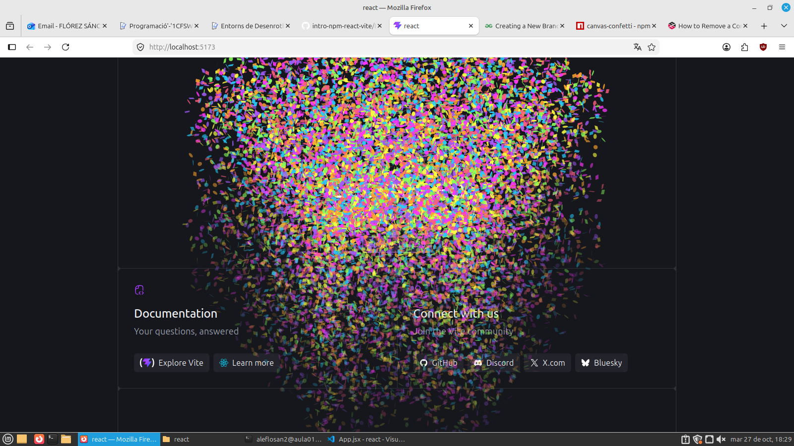
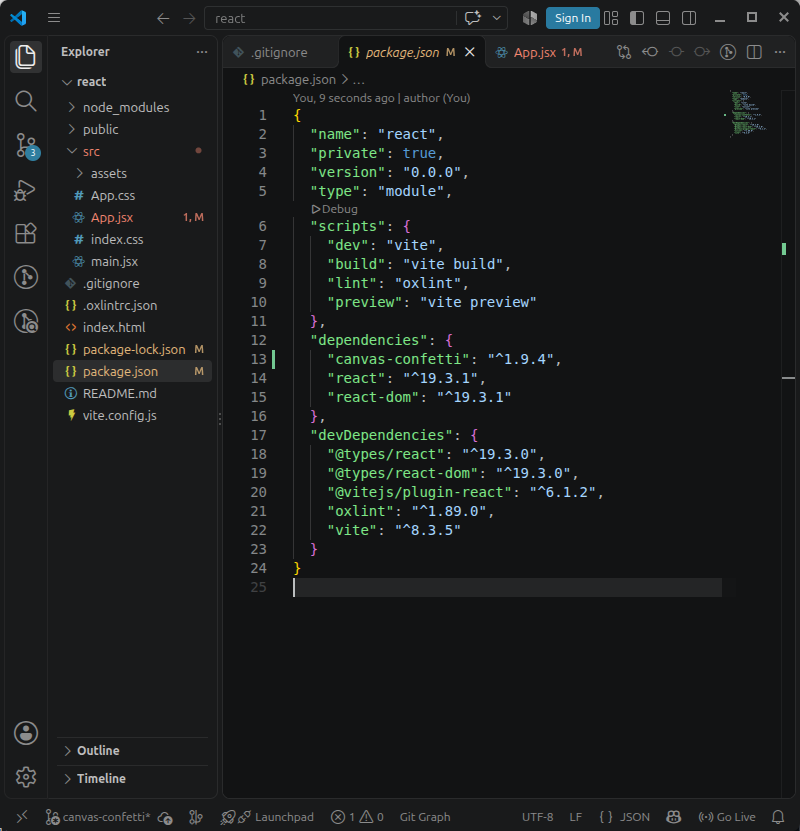
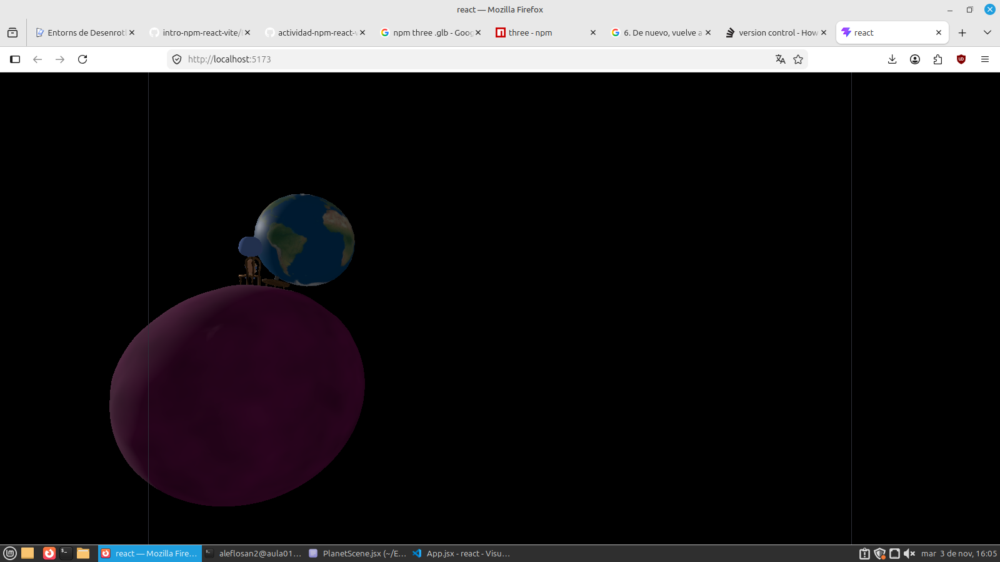

> Alex Florez - 1·DAW
# Actividad NPM-React-Vite

## Confetti

## Confetti en botón

## Package.json

## Renderizado en 3D

## Pregunta

**Si la carpeta node_modules/ está excluida, ¿borrar una dependencia hace alguna acción sobre el repositorio? ¿Cuál?**

No, si está excluída en .gitignore, no modifica directamente el repositorio Git si se borra una dependencia de esa carpeta.

